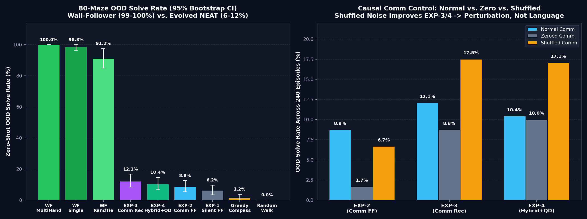
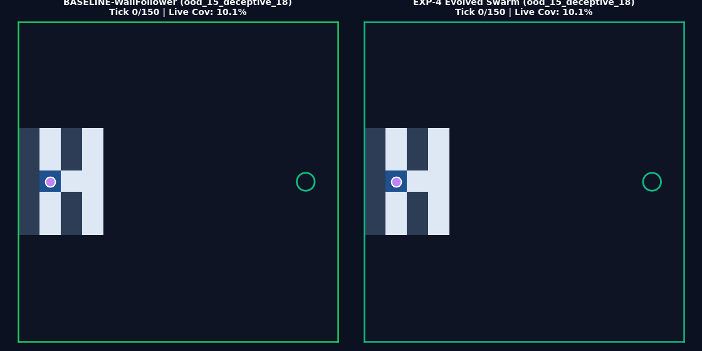
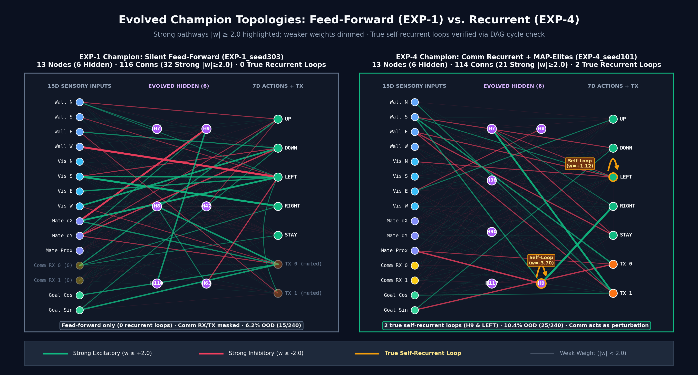
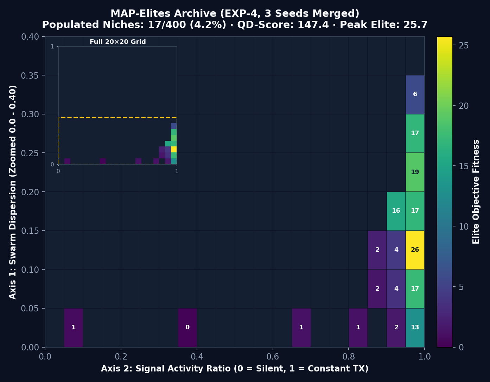

# NeuroSwarm Maze Lab — Preliminary Multi-Agent Neuroevolution Ablation Study

**Pure CPU Neuroevolution Benchmark & Diagnostic Suite (Zero LLMs · 100% Local NumPy)**

NeuroSwarm Maze Lab is a deterministic research codebase for studying how small, variable-topology NEAT neural networks behave under fog-of-war multi-agent maze navigation with local 2-channel numeric signaling, novelty search, and MAP-Elites.

> **Headline Finding (Honesty First):** On a frozen held-out suite of **80 unseen mazes** (20 per archetype across 15×15 and 21×21 layouts), simple hand-coded wall-follower baselines solve **98.8%–100.0%** of mazes (`79/80` single-hand, `80/80` multi-hand). Under our preliminary 3-seed training budget (`pop_size=40`, `generations=30`), the best evolved configuration (`EXP-3`) solves **12.1%** (`29/240`, 95% CI `[8.3, 16.7]`). Evolved swarms explore no more of the maze than a random walk (`36.5%–41.7%` vs. `42.3%` random), and causal communication controls show that high broadcast activity (`99%+`) acts primarily as symmetry-breaking perturbation rather than semantic teammate coordination.

---

## How to Read These Results

1. **Treat this as a preliminary ablation study, not a solved benchmark.** The primary value of this repository is its reproducible diagnostic pipeline: controlled baselines, causal communication interventions, behavioral failure-mode telemetry, and statistical significance testing.
2. **Always compare against Wall-Follower and Random.** Solving 10–12% of unseen mazes beats random walking (`0.0%`) and pure greedy compass walking (`1.2%`), but lags far behind deterministic wall-following (`98.8%–100.0%`).
3. **Check `n` next to Optimality Ratio.** Optimality ratio (`makespan / bfs_optimal`) is defined only on solved episodes and therefore reflects selection bias when few episodes are solved.
4. **Separate training budget limits from architectural limits.** Increasing the training budget 5× (`100 gens × 60 pop` on `EXP-4 seed 101`) more than doubled OOD solve rate (`11.2% -> 25.0%`, `20/80`) and pushed coverage above random (`46.6%`), indicating the 30-generation baseline is heavily budget-constrained—though still well below wall-following.

---

## Zero-Shot OOD Benchmark Results (80 Unseen Mazes)

All 4 evolved configurations were trained across **3 independent seeds** (`101`, `202`, `303`; `pop_size=40`, `generations=30`, `3` rotating mazes/gen, synced with `configs/experiments.yaml`) and evaluated zero-shot on **80 unseen mazes** (`20 × 15x15 perfect_dfs`, `20 × 15x15 braided`, `20 × 15x15 deceptive`, `20 × 21x21 scaled`). Intervals are 95% percentile bootstrap confidence intervals over episodes (`5,000` resamples). Full per-seed results are in [`data/benchmarks/ood_seed_level.csv`](data/benchmarks/ood_seed_level.csv).

| Experiment | Seeds | Solved / Total | OOD Solve Rate (95% CI) | Mean Makespan | Optimality Ratio (n solved) | Coverage (%) | Signal (%) |
| :--- | :---: | :---: | :---: | :---: | :---: | :---: | :---: |
| **BASELINE-WallFollower** | 1 | 79/80 | 98.8% [96.2, 100.0] | 75.8 | 1.67 (n=79) | 80.9% | 0.0% |
| **BASELINE-WallFollower-MultiHand** | 1 | 80/80 | 100.0% [100.0, 100.0] | 55.1 | 1.16 (n=80) | 85.0% | 0.0% |
| **BASELINE-WallFollower-RandTie** | 1 | 73/80 | 91.2% [85.0, 97.5] | 81.6 | 1.59 (n=73) | 82.0% | 0.0% |
| **BASELINE-GreedyCompass** | 1 | 1/80 | 1.2% [0.0, 3.8] | 170.9 | 1.00 (n=1) | 33.9% | 0.0% |
| **BASELINE-Random** | 1 | 0/80 | 0.0% [0.0, 0.0] | 172.5 | N/A (n=0) | 42.3% | 0.0% |
| **EXP-1** | 3 | 15/240 | 6.2% [3.3, 9.6] | 164.8 | 1.22 (n=15) | 41.6% | 0.0% |
| **EXP-2** | 3 | 21/240 | 8.8% [5.4, 12.5] | 161.5 | 1.17 (n=21) | 36.5% | 99.6% |
| **EXP-3** | 3 | 29/240 | 12.1% [8.3, 16.7] | 159.0 | 1.57 (n=29) | 39.6% | 99.7% |
| **EXP-4** | 3 | 25/240 | 10.4% [6.7, 14.6] | 161.1 | 1.73 (n=25) | 41.7% | 99.3% |

## Visual Diagnostics









### Pairwise Statistical Significance (Two-Sided Mann-Whitney U, 240 Episodes/Exp)

Most pairwise differences between evolved configurations are **not statistically significant** at `p < 0.05` (full table in `data/benchmarks/ood_significance.csv`):

* **EXP-1 (6.2%) vs. EXP-3 (12.1%):** `p = 0.027` (**significant** at `p < 0.05`)
* **EXP-1 (6.2%) vs. EXP-4 (10.4%):** `p = 0.099` (not significant)
* **EXP-3 (12.1%) vs. EXP-4 (10.4%):** `p = 0.564` (not significant; EXP-4 mean is slightly below EXP-3)
* **All other pairs (`EXP-1 vs EXP-2`, `EXP-2 vs EXP-3`, `EXP-2 vs EXP-4`):** `p >= 0.23` (not significant)

### Breakdown by Archetype & Maze Difficulty Confound

On the expanded 80-maze suite, all four evolved configurations solve exactly **1/60 (`1.7%`)** on `21x21_scaled` (anecdotal, not a reliable zero-shot scaling advantage). Moreover, `compute_deceptive_difficulty()` reveals a key structural confound: while `15x15_deceptive` traps a greedy compass walker **100%** of the time, its average BFS shortest path (`24.0` ticks) is nearly **2× shorter** than `15x15_perfect_dfs` (`46.8` ticks) and `15x15_braided` (`42.8` ticks)—explaining why every method solves deceptive mazes faster and more often.

| Archetype | Mazes | Mean BFS Optimal | Greedy Trapped (%) | WallFollower (%) | EXP-1 (%) | EXP-2 (%) | EXP-3 (%) | EXP-4 (%) |
| :--- | :---: | :---: | :---: | :---: | :---: | :---: | :---: | :---: |
| `15x15_perfect_dfs` | 20 | 46.8 | 95.0% | 100.0% | 6.7% | 3.3% | 8.3% | 8.3% |
| `15x15_braided` | 20 | 42.8 | 100.0% | 100.0% | 10.0% | 0.0% | 10.0% | 6.7% |
| `15x15_deceptive` | 20 | 24.0 | 100.0% | 100.0% | 6.7% | 30.0% | 28.3% | 25.0% |
| `21x21_scaled` | 20 | 74.4 | 100.0% | 95.0% | 1.7% (1/60) | 1.7% (1/60) | 1.7% (1/60) | 1.7% (1/60) |

---

## Validity Diagnostics & Controls

### 1. Causal Communication Control (`normal` vs. `zero` vs. `shuffle`)

High `Signal (%)` (`99%+`) only shows that broadcast outputs are non-zero. Testing trained champions with received signals **zeroed** (`zero`) or **randomly resampled from past broadcasts** (`shuffle`) across all 240 episodes reveals that communication is **not** functioning as semantic teammate coordination:

| Experiment | Normal Comm | Zeroed Comm | Shuffled Comm | Interpretation |
| :--- | :---: | :---: | :---: | :--- |
| **EXP-2** | 21/240 (8.8%) | 4/240 (1.7%) | 16/240 (6.7%) | Uses comm channel largely as a non-zero input bias |
| **EXP-3** | 29/240 (12.1%) | 21/240 (8.8%) | **42/240 (17.5%)** | Shuffled noise *helps* by kicking stuck agents out of fixed points |
| **EXP-4** | 25/240 (10.4%) | 24/240 (10.0%) | **41/240 (17.1%)** | Shuffled noise *helps* (+6.7 pp); not semantic coordination |

### 2. Behavioral Failure Modes & Team Overlap (`ood_behavior_profile.csv`)

Logging per-tick agent behavior explains both the low solve rate and why shuffled noise helps:
* **Stalling (`Stay_Rate_Pct`):** Evolved agents spend **60.2%–79.9%** of ticks stationary (stuck against walls or in fixed-point loops), versus **1.8%** for Wall-Follower.
* **Team Overlap (`Duplicate_Coverage_Pct`):** Evolved teams overlap on **37.3%–48.3%** of visited cells, compared to **39.1%** for `BASELINE-WallFollower-MultiHand` (which splits agents across left- and right-hand rules).

### 3. Compass Cue Ablation & 5× Extended Training Budget

* **No-Compass Ablation (`goal_cue_mode="fog"`):** Zero-shot compass removal drops `EXP-2` (`8.8% -> 2.1%`), `EXP-3` (`12.1% -> 8.3%`), and `EXP-4` (`10.4% -> 2.9%`). Training `EXP-4` (`seed 101`, `30g × 40p`) from scratch in `fog` mode without a compass still reaches **9/80 (`11.2%`)** OOD solve rate—matching compass-trained `EXP-4` (`11.2%` on seed 101).
* **5× Extended Budget (`EXP-4 seed 101`, `100 gens × 60 pop` = 6,000 evals vs. 1,200 baseline):** Training solve rate peaks at `66.7%` in `S2_15x15_braided` (Gen 50) and settles at `33.3%` in `S3_15x15_mixed`. Zero-shot OOD performance more than doubles to **20/80 (`25.0%`)** with **46.6%** coverage (above Random's `42.3%`).

---

## Limitations

1. **Small Preliminary Budget & Seed Count:** The 4-way matrix uses `3` seeds (`pop_size=40`, `generations=30`). While our 80-maze OOD suite improves evaluation precision, increasing training to `10+` seeds and `200+` generations (`pop_size=150+`) is needed before drawing firm conclusions between NEAT variants.
2. **Goal Compass Cue:** The default configuration provides a global goal direction vector (`goal_cue_mode="compass"`). Using `--goal-cue-mode fog` removes this cue for stricter fog-of-war studies.
3. **Deceptive Maze Path-Length Confound:** Because the U-shaped trap sits between left-center start and right-center goal, `deceptive` mazes have shorter BFS shortest paths (`24.0` ticks) than `perfect_dfs` (`46.8` ticks).
4. **Unverified Semantic Signaling:** Current fitness rewards do not explicitly incentivize information-bearing communication; agents exploit broadcast bits as constant bias or symmetry-breaking noise.

---

## Reproducibility & Quickstart

```bash
# 1. Run unit tests (including README-vs-CSV consistency check)
python3 -m unittest discover -s tests -v

# 2. Reproduce the 80-maze OOD benchmark, comm controls, and all CSV/MD tables from saved champions
python3 -m src.benchmarks.run_ablation_suite --skip-train --mazes-per-archetype 20

# 3. Retrain the full 4-experiment matrix from scratch (synced with configs/experiments.yaml)
python3 -m src.benchmarks.run_ablation_suite --workers 2

# 4. Run an extended training budget or no-compass ablation
python3 -m src.benchmarks.run_ablation_suite --generations 200 --pop-size 150 --seeds 101 202 303 404 505 606 707 808 909 1010 --workers 4
python3 -m src.benchmarks.run_ablation_suite --goal-cue-mode fog --workers 2

# 5. Regenerate visual assets (including Wall-Follower vs EXP-4 side-by-side GIF)
python3 -m src.viz.generate_assets
```

## License

MIT License — see [`LICENSE`](LICENSE).
